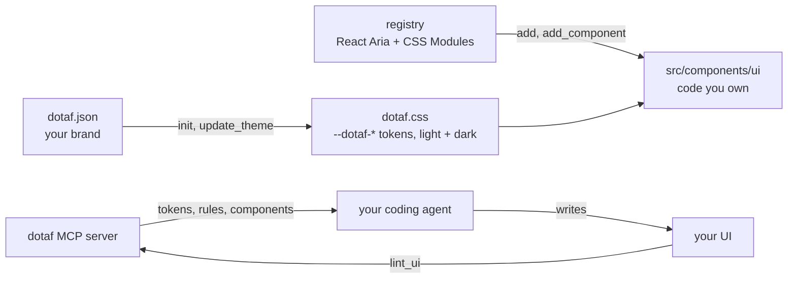
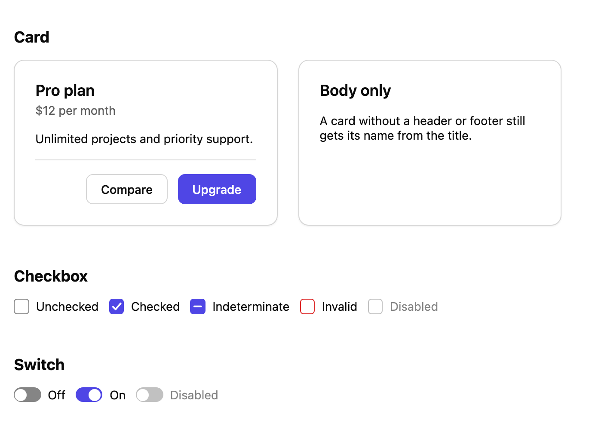

<h1 align="center">dotaf</h1>

<p align="center">
  <b>Your brand in one file. Every screen your coding agent builds stays on it.</b>
</p>

<p align="center">
  <a href="https://github.com/xasanovdev/dotaf/actions/workflows/ci.yml"></a>
  <a href="./LICENSE"></a>
  
</p>

dotaf is an open-source design system for coding agents. You describe your brand once in
`dotaf.json`: colors, fonts, corner radius and density. dotaf turns it into CSS tokens
(`--dotaf-*`) and accessible React components, and serves both to your agent (Claude Code, Cursor,
Codex and others) over [MCP](https://modelcontextprotocol.io). The agent reads the rules, uses the
components, and lints its own CSS, so the UI it writes matches your brand on the first try and the
tenth.

> [!NOTE]
> dotaf is pre-release and not on npm yet. The commands below are what v0.1 ships; until then, run
> them [from source](#run-from-source).

## Why

**Without dotaf**, an agent invents the design as it goes:

- a new hex color, padding and corner radius on every screen, close to your brand but never quite it
- a `<div onClick>` where a real button belongs, with no keyboard or screen-reader support
- dark mode as a second pass, if at all
- nothing that tells you, or the agent, that any of this happened

**With dotaf**, the agent works inside one system:

- it reads every token and what it is for, then the rules UI code follows (`get_design_system`)
- it reuses components built on [React Aria](https://react-spectrum.adobe.com/react-aria/), copied
  into your repo as code you own
- dark mode comes with the tokens, with no extra CSS
- `lint_ui` points at every raw value it wrote and names the token to use instead:

```css
.card {
  padding: 24px;
  border-radius: 12px;
  color: #0a0a0a;
  font-size: 14px;
}
```

```text
src/card.css:2:12 Use var(--dotaf-space-6) instead of 24px
src/card.css:3:18 Use var(--dotaf-radius-lg) instead of 12px
src/card.css:4:10 Use var(--dotaf-color-fg) or var(--dotaf-color-muted-fg) instead of #0a0a0a
src/card.css:5:14 Use var(--dotaf-text-sm) instead of 14px

4 problems in 1 of 3 CSS files.
```

## Quickstart

In the root of a React project (Vite, Next.js and others):

```bash
npx dotaf init
```

```bash
npx dotaf add button switch card
```

```bash
claude mcp add dotaf -- npx dotaf mcp
```

`init` asks for your brand (or takes the defaults with `--yes`), writes `dotaf.json` and
`dotaf.css`, and prints the next steps for your project, for example:

```text
Wrote dotaf.json and src/styles/dotaf.css.

Next steps
  1. Import the tokens once, in src/main.tsx:
       import "./styles/dotaf.css";
  2. Install the dependency the components use:
       npm install react-aria-components
  3. Connect your coding agent:
       claude mcp add dotaf -- npx dotaf mcp
```

Then ask your agent for UI as usual:

```text
Build a settings page with email and push notification switches and a Save button.
```

```text
Make the brand warmer: primary #ea580c, rounder corners, more spacious.
```

## How it works



1. **One source of truth.** `dotaf.json` holds the brand. `dotaf.css` is generated from it, with a
   comment on every token saying what it is for. Nobody edits `dotaf.css` by hand.
2. **Components you own.** `dotaf add` copies a component's `.tsx` and `.module.css` into your
   project, like [shadcn/ui](https://ui.shadcn.com). Every one is built on `react-aria-components`
   and styled only with tokens.
3. **An agent that knows the system.** The MCP server gives the agent the tokens, the rules and the
   components, lets it add components and change the theme, and lints what it wrote.

## Connect your agent

The server runs over stdio from your project root: `npx dotaf mcp`.

<details open>
<summary>Claude Code</summary>

```bash
claude mcp add dotaf -- npx dotaf mcp
```

</details>

<details>
<summary>Cursor</summary>

Add to `.cursor/mcp.json`:

```json
{
  "mcpServers": {
    "dotaf": {
      "command": "npx",
      "args": ["dotaf", "mcp"]
    }
  }
}
```

</details>

<details>
<summary>VS Code (Copilot)</summary>

Add to `.vscode/mcp.json`:

```json
{
  "servers": {
    "dotaf": {
      "type": "stdio",
      "command": "npx",
      "args": ["dotaf", "mcp"]
    }
  }
}
```

</details>

<details>
<summary>Codex</summary>

Add to `~/.codex/config.toml`:

```toml
[mcp_servers.dotaf]
command = "npx"
args = ["dotaf", "mcp"]
```

</details>

<details>
<summary>Other MCP clients</summary>

Most clients take this standard config:

```json
{
  "mcpServers": {
    "dotaf": {
      "command": "npx",
      "args": ["dotaf", "mcp"]
    }
  }
}
```

</details>

### MCP tools

| Tool                | What it does                                                                                   |
| ------------------- | ---------------------------------------------------------------------------------------------- |
| `get_design_system` | The rules UI code follows, and every token with its purpose and its light and dark values.     |
| `list_components`   | The dotaf components, what each is for, and which ones the project already has.                |
| `get_component`     | A component's props, an example and its npm packages, plus its source if the project lacks it. |
| `add_component`     | Copies components (and the ones they use) into the project. Never overwrites a file.           |
| `update_theme`      | Changes brand values in `dotaf.json` and regenerates `dotaf.css` at once.                      |
| `lint_ui`           | Reports raw design values in the project's CSS as `file:line:column`, with the token to use.   |

Every tool takes an optional `path`: the folder or file the agent is working in. In a monorepo, it
picks the right `dotaf.json`.

## For AI agents

If you are an agent working in a project that has a `dotaf.json`:

1. Call `get_design_system` before writing or changing UI, and follow its rules.
2. Call `list_components` before building a control. Use `get_component` for the one that fits, and
   `add_component` if the project doesn't have it yet.
3. Change the brand with `update_theme`. Never edit `dotaf.css` by hand.
4. Call `lint_ui` after writing CSS, and fix what it reports.
5. In a monorepo, pass `path`: the app folder or file you are working in.

The rules `get_design_system` returns, in short:

- Colors, spacing, radius, font family, size and weight, shadows, durations and easing come from
  `var(--dotaf-*)`, never a raw hex, px, rem or named value. Values with no token (border widths,
  line heights, icon and control sizes) stay raw.
- Use a dotaf component when one fits. Its files in the project are the project's own to read and
  edit.
- Build a new interactive control on `react-aria-components`, and style its states through the data
  attributes it sets (`[data-hovered]`, `[data-pressed]`, `[data-focus-visible]`, `[data-disabled]`,
  `[data-selected]`), not `:hover` or `:focus`.
- Show focus with `outline: var(--dotaf-focus-ring)` and
  `outline-offset: var(--dotaf-focus-ring-offset)` on `[data-focus-visible]`.
- Dark mode needs no extra CSS. Color tokens follow `prefers-color-scheme`, and `data-theme="light"`
  or `data-theme="dark"` on any element themes its subtree.

Contributing to dotaf itself? Read [AGENTS.md](./AGENTS.md).

## CLI

```text
Usage: dotaf init [--theme <file|url>] [--yes] [--force]
       dotaf add <component...> [--overwrite]
       dotaf mcp

  init                Write dotaf.json and dotaf.css for this project
    --theme <file|url>  Start from a shared dotaf.json (its brand; paths stay this project's)
    --yes               Use the defaults without asking
    --force             Let --theme replace an existing dotaf.json
  add                 Copy components into paths.components, with the ones they use
    --overwrite         Replace component files that already exist
  mcp                 Serve this project's design system to a coding agent (MCP over stdio)
```

## dotaf.json

```json
{
  "$schema": "https://unpkg.com/@dotaf/core/dotaf.schema.json",
  "colors": {
    "primary": "#4f46e5",
    "background": "#ffffff",
    "foreground": "#0a0a0a",
    "danger": "#dc2626",
    "success": "#16a34a",
    "warning": "#d97706"
  },
  "dark": {
    "background": "#0a0a0a",
    "foreground": "#fafafa"
  },
  "font": {
    "sans": "Inter, system-ui, sans-serif",
    "mono": "ui-monospace, monospace"
  },
  "radius": "md",
  "density": "comfortable",
  "paths": {
    "components": "src/components/ui",
    "css": "src/styles/dotaf.css"
  }
}
```

| Field     | Values                                                                                      |
| --------- | ------------------------------------------------------------------------------------------- |
| `colors`  | Brand colors for light mode. Hover, muted, border and `on-*` colors are derived from these. |
| `dark`    | Colors that change in dark mode.                                                            |
| `font`    | Font stacks for interface text (`sans`) and code (`mono`).                                  |
| `radius`  | `none`, `sm`, `md`, `lg` or `full`: how round corners are, across every component.          |
| `density` | `compact`, `comfortable` or `spacious`: the base spacing unit every `space-*` step scales.  |
| `paths`   | Where `dotaf add` puts components and where `init` writes `dotaf.css`.                      |

The `$schema` line gives you autocomplete and validation in your editor.

## Tokens

`dotaf.css` defines these groups. Each token carries a comment saying what it is for, and
`get_design_system` gives an agent the same descriptions.

| Group  | Tokens                                                                                                                                                                                                                                                                |
| ------ | --------------------------------------------------------------------------------------------------------------------------------------------------------------------------------------------------------------------------------------------------------------------- |
| Color  | `color-bg`, `color-fg`, `color-muted`, `color-muted-fg`, `color-border`, `color-control-border`, `color-primary`, `color-primary-hover`, `color-on-primary`, `color-danger`, `color-danger-hover`, `color-on-danger`, `color-success`, `color-warning`, `color-scrim` |
| Space  | `space-1`, `space-2`, `space-3`, `space-4`, `space-6`, `space-8`, `space-12`, `space-16`                                                                                                                                                                              |
| Radius | `radius-sm`, `radius-md`, `radius-lg`, `radius-full`                                                                                                                                                                                                                  |
| Type   | `font-sans`, `font-mono`, `text-xs` to `text-2xl`, `font-weight-normal`, `font-weight-medium`, `font-weight-semibold`                                                                                                                                                 |
| Depth  | `shadow-sm`, `shadow-md`, `shadow-lg`                                                                                                                                                                                                                                 |
| Motion | `duration-fast`, `duration-normal`, `ease-out` (durations drop to 0ms under `prefers-reduced-motion`)                                                                                                                                                                 |
| State  | `focus-ring`, `focus-ring-offset`, `opacity-disabled`, `target-min` (smallest hit area: 24px, 44px on touch screens)                                                                                                                                                  |

Every name is prefixed: `color-primary` is `var(--dotaf-color-primary)`.

## Components

<picture>
  <source media="(prefers-color-scheme: dark)" srcset=".github/assets/playground-dark.png">
  
</picture>

20 components, each built on `react-aria-components` and styled only with tokens.

### Actions

| Component | Parts                                                                                         | Use it for                                 |
| --------- | --------------------------------------------------------------------------------------------- | ------------------------------------------ |
| `button`  | `Button` with `variant` (primary, secondary, ghost, danger), `size` (sm, md, lg), `isPending` | An action: save, submit, delete            |
| `menu`    | `MenuTrigger`, `Menu`, `MenuItem` (with `variant="danger"`), `MenuSeparator`                  | A list of actions that opens from a button |

### Forms

| Component        | Parts                                                                                                                   | Use it for                                                         |
| ---------------- | ----------------------------------------------------------------------------------------------------------------------- | ------------------------------------------------------------------ |
| `form`           | `Form`, `FormActions`                                                                                                   | Submit on Enter, focus the first invalid field, show server errors |
| `text-field`     | `TextField`, `TextFieldLabel`, `TextFieldInput`, `TextFieldPasswordInput`, `TextFieldDescription`, `TextFieldError`     | One line of text, or a password with a show button                 |
| `text-area`      | `TextArea`, `TextAreaLabel`, `TextAreaInput`, `TextAreaDescription`, `TextAreaError`                                    | Multi-line text that grows as you type                             |
| `number-field`   | `NumberField`, `NumberFieldLabel`, `NumberFieldInput`, `NumberFieldDescription`, `NumberFieldError`                     | Quantities, amounts and percentages, with − and + steps            |
| `checkbox`       | `Checkbox`, including indeterminate and invalid states                                                                  | One option on or off, applied on submit                            |
| `checkbox-group` | `CheckboxGroup`, `CheckboxGroupLabel`, `CheckboxGroupDescription`, `CheckboxGroupError`, with a `Checkbox` per option   | Any number of several options                                      |
| `radio-group`    | `RadioGroup`, `RadioGroupLabel`, `Radio`, `RadioGroupDescription`, `RadioGroupError`                                    | Exactly one of 2 to about 5 visible options                        |
| `select`         | `Select`, `SelectLabel`, `SelectTrigger`, `SelectPopover`, `SelectItem`, `SelectDescription`, `SelectError`             | One of about 4 to 15 options                                       |
| `combobox`       | `Combobox`, `ComboboxLabel`, `ComboboxInput`, `ComboboxPopover`, `ComboboxItem`, `ComboboxDescription`, `ComboboxError` | One of a long list, filtered by typing                             |
| `switch`         | `Switch`                                                                                                                | A setting that applies at once                                     |

### Overlays

| Component | Parts                                                                                        | Use it for                                          |
| --------- | -------------------------------------------------------------------------------------------- | --------------------------------------------------- |
| `dialog`  | `DialogTrigger`, `Dialog`, `DialogTitle`, `DialogDescription`, `DialogFooter`, `DialogClose` | A modal for a confirmation, a short form or details |
| `tooltip` | `TooltipTrigger`, `Tooltip`                                                                  | A short hint for an icon-only button                |

### Layout and status

| Component   | Parts                                                               | Use it for                             |
| ----------- | ------------------------------------------------------------------- | -------------------------------------- |
| `tabs`      | `Tabs`, `TabList`, `Tab`, `TabPanel`                                | Panels of related content in one place |
| `card`      | `Card`, `CardHeader`, `CardTitle`, `CardBody`, `CardFooter`         | A surface that groups related content  |
| `badge`     | `Badge` with `variant` (neutral, primary, success, warning, danger) | A status label: Active, Draft, Failed  |
| `separator` | `Separator` with `orientation` (horizontal, vertical)               | A line between groups of content       |

`dotaf add` brings the components a component uses along with it: `checkbox-group` adds
`checkbox`. Each one is tested in a real browser: keyboard use and focus, accessible names, contrast
in light and dark, touch-sized hit areas, and, where they apply, forced colors and right-to-left
layout.

Larger components are split into named parts, so they work in Next.js server components. Each
component's folder has an `index.ts`, so you import the folder:

```tsx
import { Button } from "@/components/ui/button";
import { Card, CardBody, CardFooter, CardHeader, CardTitle } from "@/components/ui/card";

export function ProPlan() {
  return (
    <Card>
      <CardHeader>
        <CardTitle>Pro plan</CardTitle>
      </CardHeader>
      <CardBody>Unlimited projects and priority support.</CardBody>
      <CardFooter>
        <Button variant="secondary">Compare</Button>
        <Button>Upgrade</Button>
      </CardFooter>
    </Card>
  );
}
```

## Lint in CI

The rule behind `lint_ui` is a [Stylelint](https://stylelint.io) plugin. Use it in your own lint
step so a raw value never lands, whoever wrote it:

```bash
npm install -D stylelint @dotaf/stylelint-config
```

```json
{
  "extends": ["@dotaf/stylelint-config"]
}
```

## Packages

| Package                                                  | What it is                                                           |
| -------------------------------------------------------- | -------------------------------------------------------------------- |
| [`dotaf`](./packages/cli)                                | The `npx dotaf` command: `init`, `add` and `mcp`.                    |
| [`@dotaf/mcp`](./packages/mcp)                           | The MCP server.                                                      |
| [`@dotaf/core`](./packages/core)                         | The engine: schema, CSS generation, component install and lint runs. |
| [`@dotaf/registry`](./packages/registry)                 | Component sources and the API to list and read them.                 |
| [`@dotaf/stylelint-config`](./packages/stylelint-config) | The `dotaf/use-tokens` rule.                                         |

`apps/playground` shows every component in every variant, in light and dark.

## Run from source

Until v0.1 is on npm. You need Node.js 22 or newer and pnpm.

```bash
git clone https://github.com/xasanovdev/dotaf.git
```

```bash
cd dotaf && pnpm install && pnpm build
```

Then, in your project, call the built CLI wherever these docs say `npx dotaf`:

```bash
node /path/to/dotaf/packages/cli/dist/index.js init
```

## Contributing

```bash
pnpm install
```

```bash
pnpm check
```

```bash
pnpm --filter @dotaf/playground dev
```

`pnpm check` runs format, lint (ESLint and Stylelint), typecheck, tests and build. It must pass
before a change is reviewed. [AGENTS.md](./AGENTS.md) holds the package boundaries and the quality
gate, and points to the component rules, for people and agents alike.

## Roadmap

- **v0.1:** `dotaf theme`, `dotaf lint` and `dotaf list` in the CLI; registering a project's own
  components with dotaf; raised-surface tokens for dark mode; validation errors shown when a field
  is left; publishing to npm.
- **v1.0:** reading the brand from an existing project or a reference; a web theme editor; a theme
  gallery.

## License

[MIT](./LICENSE)
